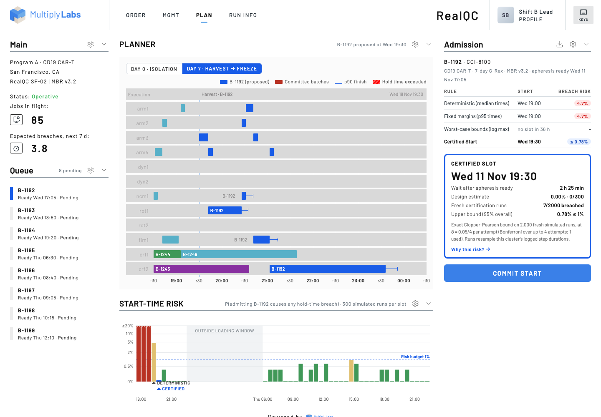

# Certified Start · risk-certified job admission for a Multiply Labs cluster

**Live demo:** https://mohith26.github.io/multiply-certified-start/ · unofficial concept by Mohith Gajjela, not affiliated with Multiply Labs.

When an operator schedules a new manufacturing job from the Dashboard, the Planner allocates its steps to the cluster's modules. A deterministic plan can be conflict-free on paper and still put a batch at real risk: if a Rotea run or a freezer profile runs long, the next batch's harvest-to-wash or DMSO-exposure hold time is breached. **Certified Start** gives every candidate start time a measured probability that admitting the batch causes *any* validated hold-time breach (its own, or one it pushes onto a committed batch), and recommends the earliest start whose risk is **certified below a budget (1% by default) with 95% confidence**. It lives in the Planner, next to the existing PLAN view, with a drill-down that explains which hold time and which module drive the risk.



## Results (from `data/results.json`, reproduced by the tests)

Demo cluster: 4 arms, 2 DynaCellect, 1 NC-200, 2 Rotea, 1 fill module, 2 controlled-rate freezers, 16 incubators; about 12 starts/day (≈4,400 doses/yr, inside Multiply's published 2,000-10,000 per cluster). Eight batches are waiting for a start time. Each option's risk is re-measured on 2,000 held-out simulated runs that neither the planner nor the certifier saw.

| Rule | Slots over the 1% budget | Mean breach risk | Max breach risk | Expected added breaches (8 admissions) | Mean wait after apheresis ready |
|---|---|---|---|---|---|
| Deterministic, median durations | **7 of 8** | 4.2% | 11.9% | 0.34 | 1.1 h |
| Fixed margins, every step at its p95 | 6 of 8 (same slot as deterministic 7 times) | 4.2% | 11.9% | 0.33 | 1.2 h |
| Worst-case bounds (log maximum) | no feasible slot within 36 h for any batch | n/a | n/a | n/a | n/a |
| **Certified Start** | **0 of 8** | 0.21% | 0.65% | 0.017 | 2.9 h (median +60 min vs deterministic) |

Example (first request, B-1192): the deterministic planner's slot (Wed 19:00) breaches a hold time in 5.45% of held-out runs, almost always the 60-minute DMSO-exposure limit while waiting for a freezer. Certified Start picks 19:30: 7 breaches in 2,000 fresh certification runs, Clopper-Pearson upper bound 0.78% ≤ 1%; held-out estimate 0.35%.

Two findings worth stating plainly: padding every step to its p95 does not help, because the risk comes from the joint tail (two long steps on neighbouring batches) and from dispatch order, not from any single step; and worst-case bounds are infeasible at this load. A probabilistic budget is the only one of the three that both admits work and controls risk.

## How it works

1. **Duration model from run logs.** Digital QC already records every step. `data/logs.json` holds 600 logged durations per step type (synthetic here, seeded from public figures); scenarios resample them (nonparametric bootstrap), with a deterministic hash per (scenario, batch, step) so every candidate start is evaluated on the *same* draws (common random numbers).
2. **Execution simulator.** A discrete-event simulator runs the plan the way an orchestrator would: steps release at their recipe anchors or when their predecessor finishes, wait for a free arm and a free module instance, and are dispatched earliest-deadline-first (deadline = the hold time or timing window on that step). A breach is a step starting after its validated limit.
3. **Counterfactual added risk.** For a candidate start, the same draws are simulated with and without the new batch; a run counts only if admitting the batch creates a breach. A windowed simulation around the new batch's steps makes this fast; it falls back to the full simulation whenever the perturbation has not died out by the window end, so it is exact (a randomized test checks windowed = full).
4. **Certification.** A 300-run design pass scores every candidate on a 30-minute grid inside the loading window (06:00-22:00). Walking forward in time, the first candidate with a design estimate ≤ 0.67 × budget is re-tested on 2,000 *fresh* runs; it is certified if the exact Clopper-Pearson upper bound at δ = 0.05/4 is ≤ budget (Bonferroni over at most 4 attempts, so the overall statement holds at 95%). Otherwise the next candidate is tried.
5. **Baselines** use the same simulator with every duration at its log median, p95 or maximum.

The guarantee is conditional on the simulator: it bounds the breach probability *under the logged duration distribution and this dispatch rule*. That is the honest scope of any certificate built from historical runs.

## The app

- **PLAN** (Planner): Gantt of arms and modules around the batch's Day 0 isolation or Day 7 harvest-to-freeze chain (median times, p90 finish whiskers, red stripes where a hold time is exceeded), the start-time risk strip with the deterministic and certified picks, and the admission panel with all four rules side by side.
- **Drill-down** (`Why this risk?`): breaches by hold time, which module the late step was waiting for, the batch's DMSO-exposure distribution against the 60-minute limit, and the breaching runs.
- **Actions**: click any slot, certify it on demand, commit (certified, or with a logged override), export the risk curve (CSV) and certificate (JSON). Committing re-plans the rest of the queue against the new plan in a Web Worker.
- **ORDER** (queue and committed batches with their certified bounds), **MGMT** (module cards with 7-day utilization, risk budget), **RUN INFO** (admission log with certificates, the duration logs the model learns from).
- Deep links (`#/plan?b=B-1193&slot=840&win=d0`), state in localStorage, keyboard shortcuts (`?`), loading/empty/error states, 1280 px and up.

## Data

All synthetic, seeded by `scripts/seed.mjs` from public figures:

- Cluster shape: 4 UR arms, up to 24 instrument modules, 2,000-10,000 doses/yr per cluster ([multiplylabs.com/product](https://www.multiplylabs.com/product)). Instruments on the product page: DynaCellect, Rotea, NC-200, Heracell VIOS, G-Rex.
- DynaCellect isolation ≈ 70-100 min ([Thermo Fisher](https://www.thermofisher.com/us/en/home/bioprocessing/products/cell-therapy/gibco-cts-dynacellect.html)); Rotea T-cell wash and concentrate, 3 L in 38 min ([Rotea brochure](https://documents.thermofisher.com/TFS-Assets/BID/brochures/cts-rotea-counterflow-centrifugation-system-brochure.pdf)).
- DMSO exposure before freezing limited to under 1 h ([Vox Sanguinis 2015, PMID 25899864](https://pubmed.ncbi.nlm.nih.gov/25899864/)). Other hold times (harvest → wash 45 min, wash → count 30 min, etc.) are illustrative values in the range CAR-T batch records use.
- The committed plan was built by replaying ~12 requests/day through the fixed-margin (p95) rule, which is why it carries 3.8 expected breaches over the next week (shown on the Main panel).

## Tests and reproducibility

```bash
node scripts/seed.mjs      # regenerate data (deterministic)
node scripts/results.mjs   # ~80 s: data/results.json + data/precomputed.json
node --test test/*.test.mjs
python3 -m http.server     # open http://localhost:8000
```

14 tests: Clopper-Pearson closed form and exact-CDF checks, a randomized coverage property test, incomplete-beta symmetry, bootstrap sampler quantiles, precedence and anchor invariants, a randomized "no module or arm is double-booked" property, a constructed freezer collision with exact lateness, a randomized windowed-equals-full simulation check, reproducibility under common random numbers, the loading-window grid, the certified slot being the earliest admissible one, and the headline numbers reproducing from committed data. CI runs them on every push (`.github/workflows/test.yml`).

## Prior art and what is new

- Multiply Labs' **Planner** "allocates the various steps of the process to the modules" to maximize parallelism and throughput (archived Digital QC page); its patents cover the no-code workflow GUI (US 2025/0224858) and compiled parallel workflows (US 12,656,765). Neither describes duration uncertainty or a probabilistic admission rule; I found no public mention of one.
- Cellares (a competitor) patents contention monitoring and loading schedules for parallel cartridges (US 2024/0254426): deterministic, no risk bound.
- Fraunhofer/RWTH's CAR-T scheduling and control system (2024) schedules so that maximum-delay constraints hold *for any realization* of uncertain step durations: the worst-case approach, which this demo shows is infeasible at high load.
- Chance-constrained and stochastic scheduling and robotic-cell scheduling under uncertainty are established in OR (e.g. IISE Transactions 2019). The new part here is the combination for a robotic CGT cluster: a counterfactual "added breach" metric under common random numbers, learned from the execution logs the platform already keeps, and an exact finite-sample certificate attached to each admission decision in the operator's Dashboard.

## Limitations

- Synthetic logs and plan; step durations are drawn independently (no batch-level correlation, no drift). Real logs would need per-process, per-instrument fits and drift monitoring.
- The dispatcher (EDF, non-delay, any free arm) is a stand-in for Multiply's orchestration layer; the certificate is only as good as that model. Arm reach zones, consumable loading by operators, VHP cycles and failures that abort a batch are not modelled.
- Incubator capacity is configured (96 G-Rex slots vs. at most 86 in flight) but not simulated.
- The budget is per admission, not plan-wide; the grid is 30 minutes; Bonferroni over attempts is conservative.
- UI rebuilt from Multiply's published Dashboard and Planner mockups (2022-2024 website) and patent figures; the current production app may differ.

Unofficial concept demo by Mohith Gajjela. Not affiliated with Multiply Labs. Synthetic data.
